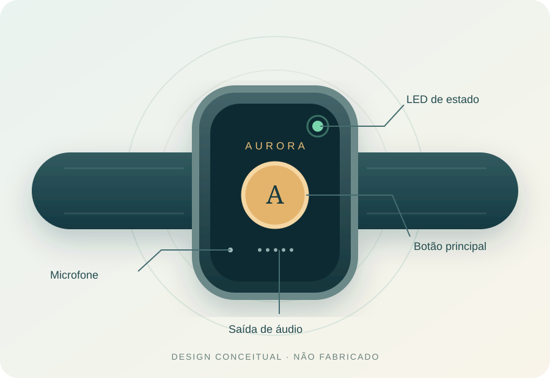

# A.U.R.O.R.A.

**Unidade Autônoma para Reforço Oral Regional e Assistência**  
Protótipo Funcional Digital para Alfabetização, Cidadania e Inclusão  
Instituto Federal de Educação, Ciência e Tecnologia de Mato Grosso — IFMT, Campus Várzea Grande

O A.U.R.O.R.A. é um demonstrador web executável para praticar alfabetização funcional, vocabulário cotidiano e cidadania. A proposta original inclui uma pulseira educacional. **A pulseira física não foi construída nem testada nesta etapa.** A ilustração e a página `/device` representam seu conceito e simulam os fluxos previstos em software.

## Início rápido

Requer Node.js 20.19+ ou 22.12+ e npm.

```bash
npm install
npm run dev
```

Abra a URL local indicada pelo Vite. Para testar a versão instalável:

```bash
npm run build
npm run preview
```

O PWA registra o service worker na compilação de produção. Visite as páginas desejadas uma vez com conexão para armazenar os assets; depois elas podem ser reabertas offline. Recursos de voz dependem do navegador e podem exigir conexão. Toda interação educacional tem fallback por texto.

## Funcionalidades

- Dez trilhas com atividades estruturadas, resposta e feedback.
- Motor determinístico local de intents e regras; **não há LLM** nesta versão.
- Entrada por texto ou reconhecimento de voz quando disponível; saída falada por SpeechSynthesis quando disponível.
- Sessões anônimas com código `AUR-XXXXXX`, ID interno distinto, verificação de colisão e armazenamento IndexedDB versionado.
- Fluxo de piloto local com consentimento, código copiável, retomada após recarga, feedback de quatro notas e SUS opcional em etapa separada.
- Área da Mentora com guia, sete módulos navegáveis, checklists, materiais e sessões locais.
- Painel com métricas calculadas, filtros `TODOS`, `REAIS`, `SINTÉTICOS` e exportação CSV/JSON identificada por origem.
- Página `/privacidade` com explicação, exportação e exclusão seletiva local.
- 25 sessões **sintéticas** geráveis e removíveis sem apagar registros locais de piloto.
- Diagnóstico de recursos do navegador e simulação conceitual do dispositivo.

## Capturas

O roteiro Playwright em `e2e/screenshots.spec.ts` gera 14 capturas em `evidence/screenshots/`, incluindo a página inicial, experiência, dispositivo, SUS, painel e viewport móvel. Veja o [índice de evidências](evidence/EVIDENCE_INDEX.md) antes de reutilizá-las em relatórios. Capturas com dados demonstrativos devem manter o rótulo **DADOS SINTÉTICOS**.

As 12 capturas específicas da Sprint 2.1 ficam em `evidence/sprint-02-1/` e mostram consentimento, código, feedback, SUS, painel sintético, filtro REAL vazio, mentoria e privacidade.

O pacote final da Sprint 3.1 reúne 15 capturas em `evidence/final/`, incluindo `/projeto`, `/creditos` e uma viewport móvel. Elas são registros técnicos produzidos por Playwright, não fotografias de campo.


## Arquitetura

`src/data.ts` contém conteúdo e vocabulário; `src/core.ts` implementa normalização, intents, progressão, SUS e geração sintética; `src/storage.ts` define o `StorageAdapter` IndexedDB v2; `src/analytics.ts` e `src/export.ts` calculam indicadores e arquivos. `Experience`, `Pilot`, `Mentor`, `Dashboard` e `Privacy` mantêm os fluxos de interface. `public/sw.js` mantém cache dos assets locais. Um adapter remoto pode ser implementado futuramente; nenhum backend existe nesta versão. Detalhes: [decisão do motor local](docs/arquitetura/DECISAO_MOTOR_LOCAL.md), [privacidade](docs/arquitetura/PRIVACIDADE_E_DADOS.md) e [exportações](docs/arquitetura/FORMATO_EXPORTACAO.md).

## Conceito do Dispositivo Vestível

O projeto original prevê futura implementação física do A.U.R.O.R.A. Nesta fase foi desenvolvido e testado o **protótipo funcional digital**. As representações visuais da rota `/device` mostram como a camada lógica e pedagógica poderia ser materializada em hardware em etapa posterior. São **designs conceituais**, não fotografias ou testes de uma pulseira fabricada.

Os [SVGs editáveis](public/aurora-device/svg/) apresentam vistas frontal e lateral, componentes, fluxo, arquitetura e estados. O [conceito físico](docs/sprint-04/01_CONCEITO_DISPOSITIVO.md), os [requisitos conceituais](docs/sprint-04/02_REQUISITOS_FISICOS_CONCEITUAIS.md) e o [plano de prototipagem futura](docs/sprint-04/08_PLANO_PROTOTIPAGEM_FISICA_FUTURA.md) explicam hipóteses e verificações pendentes. Há versões nas rotas `/device-report`, `/device-presentation` e `/device-poster` para relatório, apresentação e pôster.



## Testes

```bash
npm run typecheck
npm run build
npm run test
npm run test:e2e
npm run screenshots
```

Os testes E2E usam Playwright em desktop e viewport móvel. Consulte [QA_REPORT.md](docs/qa/QA_REPORT.md) e [FINAL_QA_REPORT.md](FINAL_QA_REPORT.md) para o resultado efetivamente verificado.

## Privacidade e ética

Nenhum nome ou CPF é solicitado. Dados inseridos no piloto desta versão ficam somente no navegador usado; não há sincronização nem envio à equipe. Evite digitar dados sensíveis. Os registros de demonstração têm `synthetic: true`, recebem identificação visual e não são atendimentos reais. Códigos de sessão não identificam participantes únicos. O fluxo de piloto está preparado para futura aplicação, sujeita a autorização, governança e documentação institucional.

## Estrutura e documentação

`docs/` organiza as cinco metas, arquitetura, requisitos, QA, evidências, encerramento e a [Sprint 2.1](docs/sprint-02-1/RELATORIO_SPRINT_02_1.md). `evidence/` guarda capturas e artefatos verificados. A [matriz de rastreabilidade](docs/encerramento/01_MATRIZ_RASTREABILIDADE.md) liga objetivo, requisito, função, teste e evidência. [SPRINT_STATUS.md](docs/SPRINT_STATUS.md) descreve o estado das entregas.

A [Sprint 4](docs/sprint-04/07_RELATORIO_SPRINT_04.md) documenta a materialização visual conceitual do wearable e suas capturas em `evidence/sprint-04/`. Essas peças não alteram o status do hardware físico.

A [matriz de metas e evidências](docs/encerramento/02_MATRIZ_METAS_EVIDENCIAS.md) distingue implementação, preparação e atividades não executadas. O [relatório final base](docs/encerramento/RELATORIO_FINAL_AURORA_BASE.md), a [conclusão](docs/encerramento/CONCLUSAO_PROJETO.md), o [guia SUAP](docs/encerramento/GUIA_PREENCHIMENTO_SUAP.md), os [anexos](docs/encerramento/ANEXOS.md) e a [auditoria de alegações](docs/encerramento/CLAIMS_AUDIT.md) compõem o pacote de encerramento técnico.

## Limitações e próximos passos

O conteúdo pedagógico requer revisão com a comunidade. Não há teste com participantes ou avaliação de eficácia pedagógica nesta entrega. Reconhecimento de voz e saída falada variam entre navegadores. Futuras etapas: protocolo de piloto, formação institucional da mentora, validação acessível, governança de dados remotos e eventual construção da pulseira física.

## Equipe e créditos

**Coordenação:** Prof. Carlos Gracioli Neto.

**Equipe discente:** Emanuelli Prado Sales; Jenniffer Karla da Silva Araujo; Juliana Silva de Jesus; Maria Isabel Borba Dranka; Nathalia de Souza Leite; Thayanne Melgueiro da Silva Bezerra Pinheiro.

Responsabilidades documentadas: Jenniffer — Metas 1 e 4; Juliana — Meta 2; Nathalia — Meta 3; Emanuelli — atividade de relatório técnico na Meta 5; Thayanne — atividade de vídeo demonstrativo/artigo na Meta 5. Maria Isabel integra a equipe, sem atribuição de atividade específica na documentação disponível. A página `/creditos` apresenta a equipe e o estado do produto. Essas vinculações não são prova de execução individual de atividades de campo ou divulgação externa.

## Licença

A definição de licença de distribuição permanece pendente de decisão institucional; nenhum direito de uso externo é presumido.
