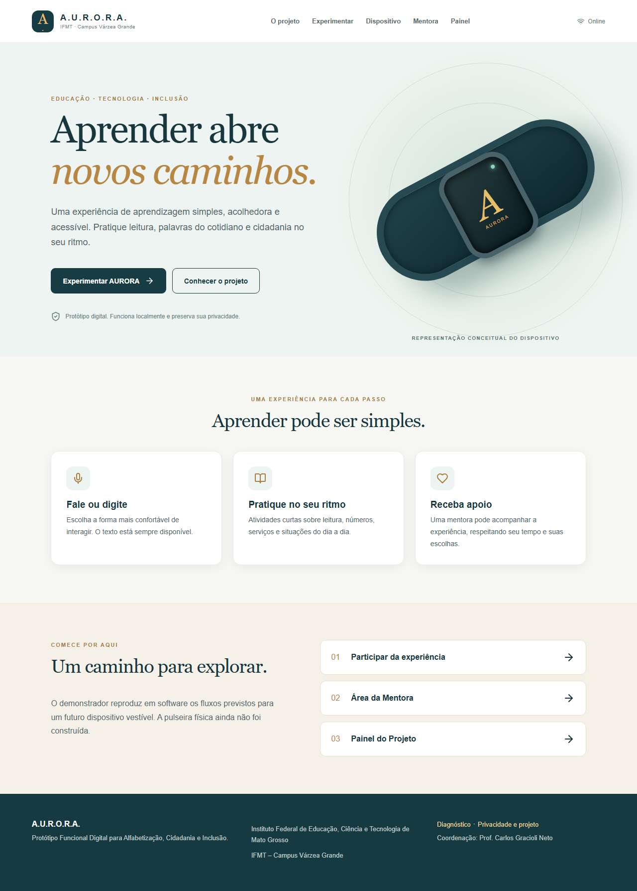
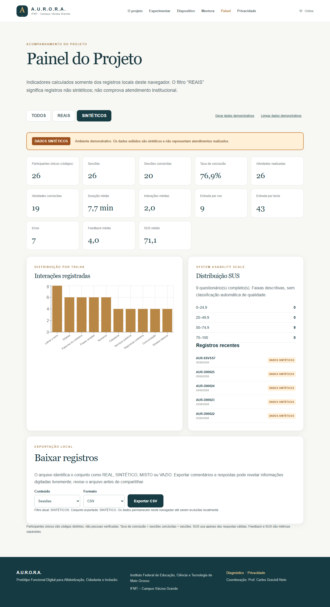

# A.U.R.O.R.A.

**Unidade Autônoma para Reforço Oral Regional e Assistência**  
Protótipo Funcional Digital para Alfabetização, Cidadania e Inclusão  
Instituto Federal de Educação, Ciência e Tecnologia de Mato Grosso — IFMT, Campus Várzea Grande

O A.U.R.O.R.A. é um demonstrador web executável para praticar alfabetização funcional, vocabulário cotidiano e cidadania. A proposta original inclui uma pulseira educacional. **A pulseira física não foi construída nem testada nesta etapa.** A ilustração e a página `/device` representam seu conceito e simulam os fluxos previstos em software.

## Início rápido

Requer Node.js 20.19+ ou 22.12+ e npm.

```bash
npm install
npm run dev
```

Abra a URL local indicada pelo Vite. Para testar a versão instalável:

```bash
npm run build
npm run preview
```

O PWA registra o service worker na compilação de produção. Visite as páginas desejadas uma vez com conexão para armazenar os assets; depois elas podem ser reabertas offline. Recursos de voz dependem do navegador e podem exigir conexão. Toda interação educacional tem fallback por texto.

## Funcionalidades

- Dez trilhas com atividades estruturadas, resposta e feedback.
- Motor determinístico local de intents e regras; **não há LLM** nesta versão.
- Entrada por texto ou reconhecimento de voz quando disponível; saída falada por SpeechSynthesis quando disponível.
- Sessões anônimas com código `AUR-XXXXXX`, guardadas em IndexedDB.
- Fluxo de piloto local com consentimento, tutorial, experiência, feedback e SUS opcional.
- Área da Mentora com guia, formação demonstrativa, vocabulário inicial de desenvolvimento e sessões locais.
- Painel com métricas calculadas dos registros armazenados e filtros `TODOS`, `REAIS`, `SINTÉTICOS`.
- 25 sessões **sintéticas** geráveis e removíveis sem apagar registros locais de piloto.
- Diagnóstico de recursos do navegador e simulação conceitual do dispositivo.

## Capturas

O roteiro Playwright em `e2e/screenshots.spec.ts` gera 14 capturas em `evidence/screenshots/`, incluindo a página inicial, experiência, dispositivo, SUS, painel e viewport móvel. Veja o [índice de evidências](evidence/EVIDENCE_INDEX.md) antes de reutilizá-las em relatórios. Capturas com dados demonstrativos devem manter o rótulo **DADOS SINTÉTICOS**.





## Arquitetura

`src/data.ts` contém conteúdo e vocabulário; `src/core.ts` implementa normalização, intents, progressão, SUS e geração sintética; `src/storage.ts` é o adapter IndexedDB; `src/App.tsx` contém os fluxos de interface. `public/sw.js` mantém cache dos assets locais. A interface `PersistenceAdapter` permite adicionar armazenamento remoto no futuro. Detalhes: [decisão do motor local](docs/arquitetura/DECISAO_MOTOR_LOCAL.md).

## Testes

```bash
npm run typecheck
npm run build
npm run test
npm run test:e2e
npm run screenshots
```

Os testes E2E usam Playwright em desktop e viewport móvel. Consulte [QA_REPORT.md](docs/qa/QA_REPORT.md) e [FINAL_QA_REPORT.md](FINAL_QA_REPORT.md) para o resultado efetivamente verificado.

## Privacidade e ética

Nenhum nome ou CPF é solicitado. Dados inseridos no piloto desta versão ficam somente no navegador usado; não há sincronização nem envio à equipe. Evite digitar dados sensíveis. Os registros de demonstração têm `synthetic: true`, recebem identificação visual e não são atendimentos reais. Códigos de sessão não identificam participantes únicos. O fluxo de piloto está preparado para futura aplicação, sujeita a autorização, governança e documentação institucional.

## Estrutura e documentação

`docs/` organiza as cinco metas, arquitetura, requisitos, QA, evidências e encerramento. `evidence/` guarda capturas e artefatos verificados. A [matriz de rastreabilidade](docs/encerramento/01_MATRIZ_RASTREABILIDADE.md) liga objetivo, requisito, função, teste e evidência. [SPRINT_STATUS.md](docs/SPRINT_STATUS.md) descreve o estado das três sprints.

## Limitações e próximos passos

O conteúdo pedagógico requer revisão com a comunidade. Não há teste com participantes ou avaliação de eficácia pedagógica nesta entrega. Reconhecimento de voz e saída falada variam entre navegadores. Futuras etapas: protocolo de piloto, formação institucional da mentora, validação acessível, governança de dados remotos e eventual construção da pulseira física.

## Equipe e licença

Coordenação: **Prof. Carlos Gracioli Neto**. Desenvolvimento: **Equipe A.U.R.O.R.A. — IFMT Campus Várzea Grande**. A definição de licença de distribuição permanece pendente de decisão institucional; nenhum direito de uso externo é presumido.
